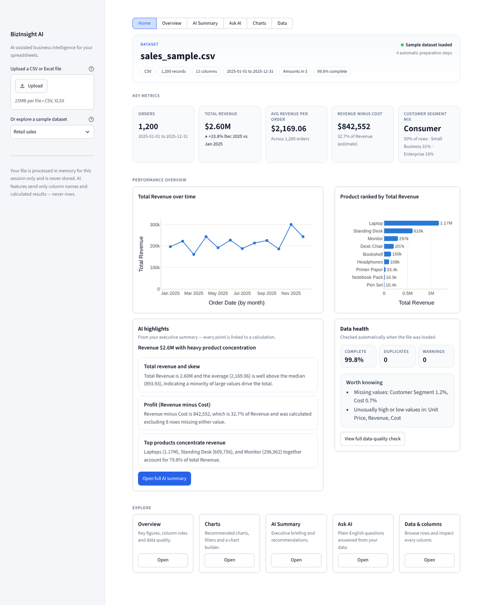
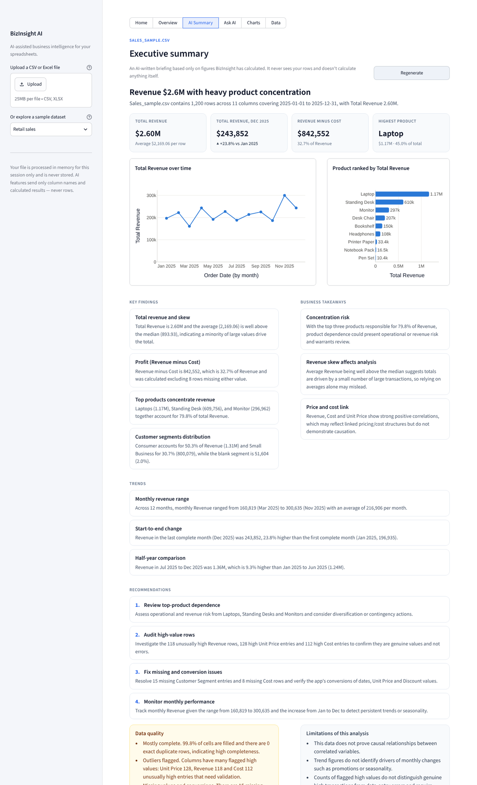
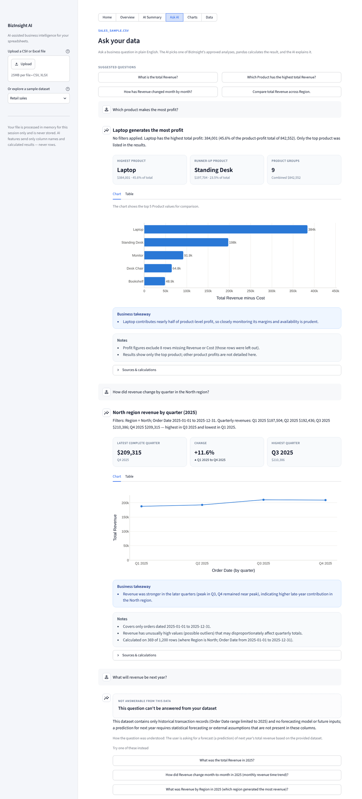
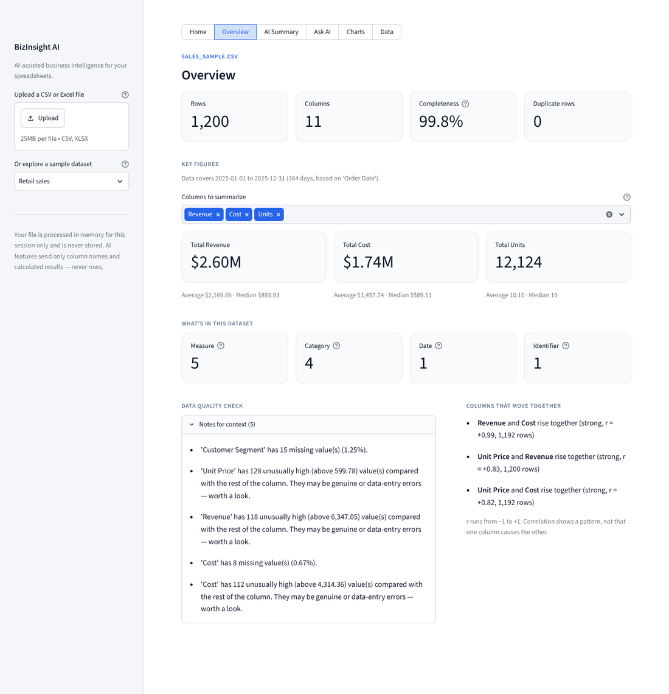
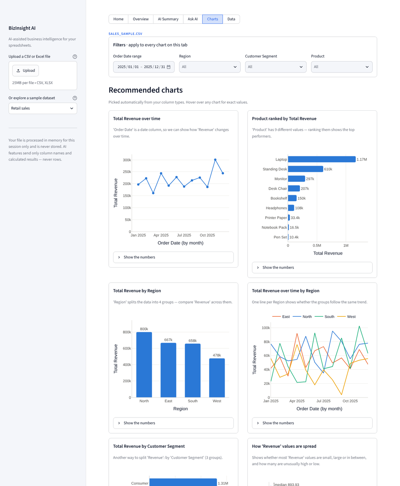
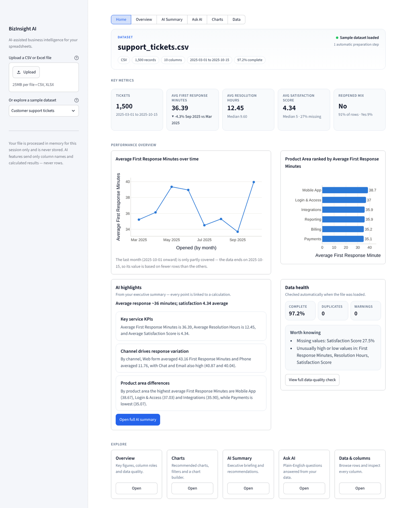
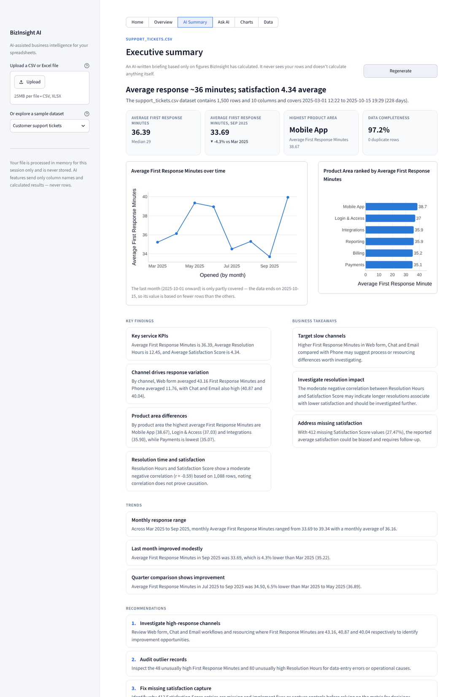
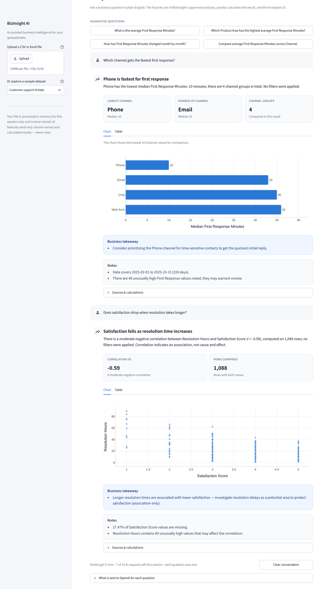
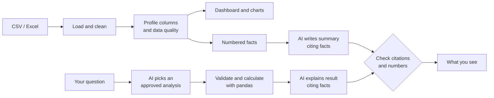
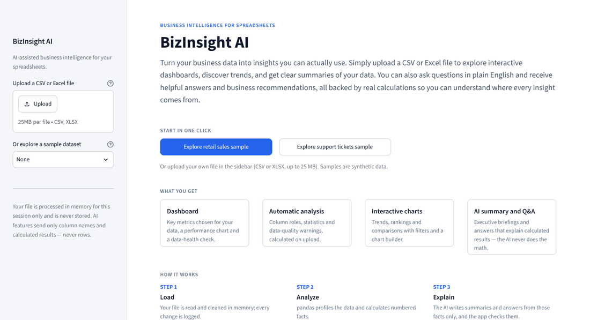

# BizInsight AI

**An AI-powered business intelligence assistant for spreadsheets.**


Turn your business data into insights you can actually use. Simply upload a CSV or Excel file to explore
interactive dashboards, discover trends, and get clear summaries of your data. You can also ask questions
in plain English and receive helpful answers and business recommendations, all backed by real calculations
so you can understand where every insight comes from.

<p align="center">
  
  <br><em>Home dashboard for the included retail sales sample.</em>
</p>

## Contents

- [Why BizInsight AI](#why-bizinsight-ai)
- [Key features](#key-features)
- [Screenshots](#screenshots)
- [Example business questions](#example-business-questions)
- [How it works](#how-it-works)
- [Architecture and project structure](#architecture-and-project-structure)
- [Technical design decisions](#technical-design-decisions)
- [AI safeguards, data privacy and limitations](#ai-safeguards-data-privacy-and-limitations)
- [Technology stack](#technology-stack)
- [Getting started (macOS)](#getting-started-macos)
- [OpenAI API configuration](#openai-api-configuration)
- [Testing and quality assurance](#testing-and-quality-assurance)
- [Future improvements](#future-improvements)
- [About this project](#about-this-project)
- [License](#license)

## Why BizInsight AI

Most small and mid-sized teams keep their business data in spreadsheets: sales exports, support-ticket
logs, inventory lists. Getting answers out of them usually means either building pivot tables and charts by
hand or setting up a full BI tool.

AI chat assistants promise a shortcut, but they have a trust problem: they often **calculate figures
themselves and get them wrong**, and it's hard to tell which numbers to believe.

BizInsight AI is built around a simple rule: **the software calculates, the AI explains.**

- Every number — totals, trends, rankings, data-quality checks — is calculated with Python and pandas.
- The AI reads those results and turns them into plain-English findings, answers and recommendations.
- Every AI statement is linked to the calculation behind it, and the app checks the AI's figures before
  showing them.

The result is the speed of an AI assistant with numbers you can verify.

## Key features

| Feature | What it gives you |
|---|---|
| **CSV and Excel upload** | Drop in a `.csv` or `.xlsx` file (multiple sheets supported, up to 25 MB). Text encodings and separators are detected automatically, and values like `$1,200`, `15%` or `2025-01-05` are converted to numbers and dates — with every change listed so nothing happens silently. |
| **Home dashboard** | An at-a-glance view of the dataset: file details, the most relevant KPIs, a performance chart, AI highlights and a data-health check. The KPIs are chosen from your columns — orders, revenue, average order value and a revenue − cost estimate for sales data; ticket volume, response and resolution times and a status mix for support data. |
| **Automatic profiling and data-quality checks** | Each column is classified (measure, category, date, ID…), summarized, and checked for duplicates, missing values, unusual values and number columns polluted with text — so you know how far to trust the data before drawing conclusions. |
| **Interactive charts and filters** | Trends, top performers, comparisons and distributions are recommended automatically from your columns, with date and category filters and a chart builder. Charts are only suggested when the data supports them, and each notes anything misleading (such as a partly covered month). |
| **AI executive summary** | A short briefing: headline, key findings, trends, business takeaways, recommendations, data-quality concerns and limitations — each statement linked to the calculated facts behind it. |
| **Plain-English Q&A** | Ask "Which product makes the most profit?" or "How did revenue change by quarter in the North?" and get a direct answer with KPI cards, a chart, a table and a business takeaway. |
| **Sources and calculations** | Every summary and answer has a *Sources & calculations* section showing the exact facts and calculation it is based on. |
| **Honest "can't answer" responses** | Questions the data can't support — forecasts, "why" questions, information that isn't in the file — get a clear explanation and suggested questions that *can* be answered, instead of a guess. |

## Screenshots

> All screenshots show the current application with its two included **synthetic** datasets.
> The AI-written text (summaries, highlights and answers) is genuine `gpt-5-mini` output, recorded from the
> live OpenAI API with [`scripts/live_check.py`](scripts/live_check.py) and replayed into the app so the
> screenshots are reproducible. As in normal use, the app displays the AI's wording with large figures
> rounded and fact references moved into *Sources & calculations*. KPI cards, charts, tables and checks are
> calculated by the app.

**AI executive summary** — headline, KPI cards, key charts, findings, takeaways and recommendations, each
linked to its supporting calculations.

<p align="center"></p>

**Plain-English Q&A** — answers with KPI cards, a chart and a takeaway; a forecast question is declined
with suggested alternatives.

<p align="center"></p>

<table>
  <tr>
    <td width="50%"><br>
      <em>Overview: key figures, column roles and the data-quality check.</em></td>
    <td width="50%"><br>
      <em>Charts: recommended charts with filters and a chart builder.</em></td>
  </tr>
  <tr>
    <td width="50%"><br>
      <em>The same dashboard for customer-support data: ticket volume, response and resolution times,
      satisfaction (with its missing-data rate) — no sales metrics invented.</em></td>
    <td width="50%"><br>
      <em>AI summary for the support-ticket sample.</em></td>
  </tr>
</table>

<p align="center">
<br><em>Questions about support tickets: the fastest channel (the model chose the median, which is robust to
outliers) and the link between resolution time and satisfaction — described as an association, not a cause.</em></p>

## Example business questions

Retail sales sample:

- What is the total revenue?
- Which product makes the most profit? *(calculated as Revenue − Cost)*
- How did revenue change by quarter in the North region?
- How many orders were over 5,000?
- Is there a relationship between unit price and revenue?
- *What will revenue be next year?* → declined: the data shows what happened, not what will happen

Customer support sample:

- Which channel gets the fastest first response?
- Does satisfaction drop when resolution takes longer?
- How many tickets were reopened in each product area?

## How it works

In everyday terms, BizInsight AI works like a careful analyst with a calculator and a writer:

1. **The calculator (Python and pandas)** reads your file, cleans it, and works out every figure: totals,
   averages, trends, rankings, and data-quality checks. These become a list of numbered *facts*, such as
   *"F12: Laptops brought in 1,170,852.80 — 45.0% of revenue."*
2. **The writer (an OpenAI model)** receives those facts — never your rows — and writes the summary,
   findings and recommendations. Every statement must point to the facts it relies on.
3. **The reviewer (Python again)** checks the writer's work. Statements that don't cite a real fact are
   removed; any figure that doesn't match a calculation is flagged on screen.

Questions work the same way. The AI doesn't answer directly; it first picks one of a small set of
**approved analyses** (for example, "total revenue minus cost, grouped by product"). The app checks that
request against your actual columns, runs it with pandas, and only then asks the AI to explain the result.



**Why this matters:** numbers come from tested code, so they are correct and reproducible; the AI's
language is checked against those numbers, so it can't quietly invent figures; and you can always open
*Sources & calculations* to see where an insight came from.

## Architecture and project structure

The code is split into a **core** package (all data logic, no user-interface code) and a **ui** package
(Streamlit pages and components). Keeping the core free of UI code means every calculation and AI check
can be tested without a browser.

```
bizinsight-ai/
├── app.py                    # Entry point: page setup, sidebar, welcome screen, navigation
├── core/                     # Data and AI logic (no Streamlit imports)
│   ├── config.py             #   Limits: file size, rows, columns, AI requests per session
│   ├── data_loader.py        #   Read, validate and clean uploads; currency detection
│   ├── profiler.py           #   Column roles, statistics, data-quality checks, correlations
│   ├── charts.py             #   Chart recommendations, aggregation, filters, Plotly figures
│   ├── formatting.py         #   Consistent number, currency, percentage and period formatting
│   ├── facts.py              #   Numbered facts the AI may cite
│   ├── highlights.py         #   KPI cards and dynamic dashboard metrics
│   ├── llm_client.py         #   OpenAI wrapper: key from environment, structured output, errors
│   ├── insights.py           #   AI summary: prompt, JSON schema, validation
│   ├── query_engine.py       #   Approved analysis operations: validate and run with pandas
│   └── qa.py                 #   Question → plan → calculate → explain → check
├── ui/                       # Streamlit pages and shared components
│   ├── home.py               #   Home dashboard
│   ├── overview.py           #   Overview and column details
│   ├── charts_tab.py         #   Charts, filters and chart builder
│   ├── summary_tab.py        #   AI Summary
│   ├── ask_tab.py            #   Ask AI
│   ├── components.py         #   KPI cards, insight cards, callouts
│   ├── state.py              #   Caching, AI settings, navigation
│   └── theme.py              #   Style sheet
├── tests/                    # Automated tests and a local fake OpenAI server
├── sample_data/              # Synthetic sample datasets (retail sales, support tickets)
├── scripts/
│   ├── make_sample_data.py   #   Regenerates the synthetic datasets
│   └── live_check.py         #   Opt-in end-to-end check against the real OpenAI API
├── docs/
│   ├── ARCHITECTURE.md       #   Detailed architecture, data flow and safeguards
│   ├── PLAN.md               #   Original development plan
│   └── screenshots/
├── .streamlit/               # Theme and upload limit; secrets.toml.example for cloud hosting
├── .env.example              # Template for your API key (the real .env is git-ignored)
├── requirements.txt          # Runtime dependencies
├── requirements-dev.txt      # Runtime + test dependencies
├── pytest.ini
├── LICENSE                   # MIT License
└── CLAUDE.md                 # Project guidelines for AI coding assistants
```

For module responsibilities, the full data flow and sequence diagrams, see
**[docs/ARCHITECTURE.md](docs/ARCHITECTURE.md)**.

## Technical design decisions

- **Calculation is separated from interpretation.** pandas does all arithmetic; the model selects and
  explains. This keeps figures deterministic and testable, and makes AI output checkable.
- **The AI fills in a plan, it never writes code.** Questions are translated into one of five approved
  operations (`aggregate`, `group_by`, `time_trend`, `correlation`, `count_distinct`) with optional
  filters, date ranges, numeric conditions and *metric minus metric*. The plan is plain data, validated
  against the real columns before pandas runs it. Nothing the model returns is ever executed as code or SQL.
- **Structured outputs everywhere.** Both AI features use OpenAI's Structured Outputs with strict JSON
  schemas, so responses have a predictable shape that can be validated field by field.
- **Column roles drive the whole app.** A single classification (measure, category, date, identifier…)
  decides which charts make sense, which KPIs appear, whether a column is totaled or averaged, and which
  operations a question may use — so the app adapts to new datasets without per-dataset code.
- **Honest presentation.** Trends use complete periods only; charts note cut-offs and partial periods;
  currency symbols appear only if the data contained one; increases and decreases are shown neutrally
  because "up" isn't always good.
- **Testable by design.** Core logic has no UI dependency, and a local fake OpenAI server lets the full
  AI flow — including error handling — be tested without a key or network access.

## AI safeguards, data privacy and limitations

**Safeguards**

- The model receives calculated facts, column names/types and category labels — never rows.
- Analysis requests are validated against approved operations and the real dataset; invalid requests are
  rejected with a plain-English reason.
- AI-generated code is never executed.
- Every statement must cite fact IDs; uncited statements are removed.
- Every figure the AI writes is compared with the calculations; mismatches are flagged on screen.
- If an answer cites no valid calculation, the app shows the calculated result directly instead.
- KPI cards are always calculated by the app, never written by the AI.
- Prompts instruct the model to treat column names and questions as data, not instructions.
- AI text is displayed with fact references removed and large figures rounded — *after* the checks have run
  on the model's original wording, so display formatting never hides a verification problem.

**Data privacy**

- Files are processed in memory for the session and never saved.
- Both AI pages explain what is sent to OpenAI, and the AI Summary page shows the exact request.
  Requests are sent with `store=False`.
- The API key is read from a git-ignored `.env` file and only ever displayed in masked form.
- AI requests are capped at 10 per browser session to protect your API credit.

**Limitations**

- One analysis per question: comparisons such as *"North in Q1 vs West in Q4"* need two questions.
- Follow-up questions only see the previous question, not the whole conversation.
- A vague question can be read differently than intended — each answer shows how it was understood and
  the exact calculation, so this is easy to spot.
- Column roles and money columns are inferred from values and names and can occasionally be wrong.
- The AI's wording can still be imperfect; the figures come from pandas, so check important points
  against the Overview and Charts pages.
- Files up to 25 MB and 500,000 rows. Legacy `.xls` files are not supported — save as `.xlsx`.
- Sessions are not saved: summaries and conversations disappear when the page is refreshed.

## Technology stack

| Area | Technology |
|---|---|
| Language | Python (developed and tested on 3.13) |
| User interface | Streamlit |
| Data analysis | pandas |
| Charts | Plotly |
| AI | OpenAI API — Responses API with Structured Outputs (default model `gpt-5-mini`, configurable) |
| Configuration | python-dotenv |
| Excel support | openpyxl |
| Testing | pytest and Streamlit's `AppTest` |

## Getting started (macOS)

These steps assume no prior setup. Commands are typed in the **Terminal** app
(Applications → Utilities → Terminal).

**1. Check for Python 3.11 or newer**

```bash
python3 --version
```

If the command is missing or shows a version below 3.11, install the latest Python from
[python.org/downloads](https://www.python.org/downloads/macos/) (or, with Homebrew, `brew install python`).
Then open a new Terminal window and check again.

**2. Get the code**

If you don't have Git, macOS will offer to install the developer tools the first time you run `git`.

```bash
cd ~/Documents
git clone https://github.com/yashitaarya/bizinsight-ai.git
cd bizinsight-ai
```

**3. Create and activate a virtual environment** (an isolated place for this project's packages)

```bash
python3 -m venv .venv
source .venv/bin/activate
```

Your prompt now starts with `(.venv)`. Run `source .venv/bin/activate` again whenever you open a new
Terminal window to work on the project.

**4. Install the dependencies**

```bash
pip install -r requirements.txt
```

**5. Start the app**

```bash
streamlit run app.py
```

Your browser opens at <http://localhost:8501>. Click **Explore retail sales sample** or
**Explore support tickets sample** to try it immediately, or upload your own CSV/Excel file in the sidebar.
Stop the app with `Ctrl+C` in Terminal.

<p align="center">
<br><em>The welcome screen: start with a sample dataset in one click, or upload your own file.</em></p>

Everything except **AI Summary** and **Ask AI** works without an API key. To enable those, continue below.

## OpenAI API configuration

The AI features use the OpenAI API, which needs **its own API key and a billing account** at
[platform.openai.com](https://platform.openai.com). This is separate from a ChatGPT subscription.

1. Sign in at [platform.openai.com](https://platform.openai.com), add a payment method and some credit
   under **Billing**, and consider setting a monthly budget limit.
2. Create a key under **API keys** and copy it.
3. In the project folder, create your private settings file from the template and open it:

   ```bash
   cp .env.example .env
   open -e .env
   ```

4. Replace the placeholder with your key and save:

   ```
   OPENAI_API_KEY=sk-...your key...
   OPENAI_MODEL=gpt-5-mini
   ```

5. Restart the app (`Ctrl+C`, then `streamlit run app.py`).

`.env` is listed in `.gitignore`, so your key is never committed. Never share it or paste it into code.

**Model and cost.** `OPENAI_MODEL` can be any model your account can use. Each summary or question
sends a few thousand tokens of calculated facts (never raw data); with a small model such as
`gpt-5-mini`, a request typically costs a fraction of a US cent. Check
[OpenAI's pricing page](https://openai.com/api/pricing/) for current rates.

**Hosting.** For Streamlit Community Cloud, put the same two values in the app's **Secrets** settings
instead of `.env` (see `.streamlit/secrets.toml.example`).

## Testing and quality assurance

```bash
pip install -r requirements-dev.txt
pytest
```

The automated suite has **220 test cases** covering every layer:

- loading and cleaning rules, profiling, charts and formatting — each calculation checked against plain pandas;
- the fact sheet, including a privacy test that no rows or IDs reach the AI request;
- the query engine, including deliberately malicious plans that must be rejected;
- the AI summary and Q&A flows: citation checks, number checks, fallbacks and unanswerable questions;
- the OpenAI client against a local fake server, for success and every error type (bad key, no credit,
  rate limits, timeouts, malformed responses);
- presentation: number and period formatting, dynamic dashboard metrics and tidying of AI text;
- the Streamlit app itself (`AppTest`): navigation, every page, the AI flows and HTML escaping.

The tests never contact OpenAI and never use your key.

**Live check.** To verify the real OpenAI integration end to end (about 11 small requests, a few cents):

```bash
python scripts/live_check.py
```

It generates summaries for both samples, asks several questions (including one that should be declined)
and prints a pass/fail report. Responses are saved to `live_check_responses.json`, which is git-ignored.

## Future improvements

- Multi-step questions and comparisons (e.g. two periods or two segments in one question).
- Conversation memory beyond the previous question.
- Exporting summaries and dashboards to PDF or slides.
- Saving sessions and summaries between visits.
- Direct connections to databases and cloud spreadsheets.
- More approved operations, such as period-over-period comparisons and pivot tables.
- Public deployment with authentication.

## About this project

BizInsight AI is an independent project exploring how AI can be used responsibly in business analytics:
pairing the speed of a language model with calculations that can be checked.

**Development approach:** Developed through AI-assisted programming, using Claude as a coding assistant for
implementation, debugging, and testing. Project direction, feature requirements, and product decisions were
guided throughout development.

The sample datasets are entirely synthetic and generated by `scripts/make_sample_data.py`.

## License

Released under the [MIT License](LICENSE). Copyright (c) 2026 yashitaarya.
