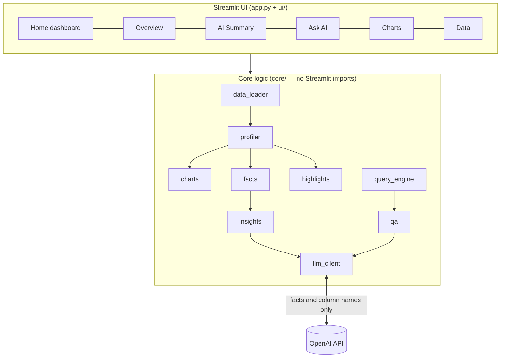
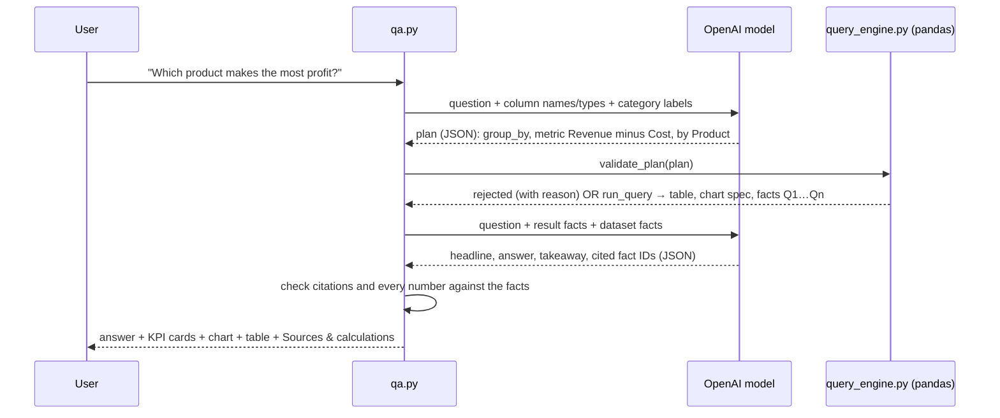

# BizInsight AI — Architecture

This document explains how BizInsight AI is put together: the core design principle, how data flows
through the system, what each module is responsible for, and the safeguards around the AI features.
For installation and a product overview, see the [README](../README.md).

## Contents

- [Design principle: calculation is separate from interpretation](#design-principle-calculation-is-separate-from-interpretation)
- [System overview](#system-overview)
- [Data flow](#data-flow)
- [Module responsibilities](#module-responsibilities)
- [The approved operations](#the-approved-operations)
- [AI safeguards in detail](#ai-safeguards-in-detail)
- [Data handling and privacy](#data-handling-and-privacy)
- [Presentation layer](#presentation-layer)
- [Testing strategy](#testing-strategy)
- [Limits and configuration](#limits-and-configuration)

## Design principle: calculation is separate from interpretation

Large language models are good at reading results and explaining them in plain language. They are not
reliable calculators: asked to total a column or compute a growth rate, they can produce numbers that look
plausible but are wrong. In a business tool, a wrong number presented confidently is worse than no number.

BizInsight AI therefore splits the work in two:

| Responsibility | Done by | Why |
|---|---|---|
| Every calculation — totals, averages, trends, rankings, correlations, data-quality checks | Python and pandas | Deterministic, unit-tested and reproducible |
| Choosing which approved analysis answers a question | OpenAI model (structured output) | Understanding language is what LLMs are good at |
| Explaining results, findings and recommendations in plain English | OpenAI model (structured output) | Communication and prioritizing what matters |
| Checking what the model wrote | Python | Citations must exist; figures must match calculations |

The model never sees raw rows and never runs code. It receives *calculated facts*, and everything it
says must cite those facts by ID. The application then checks the citations and the numbers before
anything is shown, and the user can open **Sources & calculations** to see exactly which facts and which
calculation support each statement.

## System overview

## Data flow

**1. Loading** (`core/data_loader.py`). The uploaded bytes are validated (type, size, rows, columns),
decoded (several text encodings and delimiters are tried) and cleaned. Text such as `$1,200`, `15%` or
`2025-01-05` is converted to numbers or dates only when at least 95% of a column's values convert
cleanly. Every change is written to a *cleaning log* that the user can read, and any currency symbol
found in the data is recorded so that amounts can be formatted correctly later.

**2. Profiling** (`core/profiler.py`). Each column gets a *role* that drives everything downstream:

| Role | Meaning | Example |
|---|---|---|
| measure | numbers to add up or average | Revenue, Units, Resolution Hours |
| category | a small set of repeating labels | Region, Priority |
| date | dates or times | Order Date |
| identifier | unique labels, never used for math | Order ID, Ticket ID |
| boolean | true/false | Active |
| text | free text with many values | Notes |

The profiler also computes statistics per column and runs data-quality checks: duplicates, missing
values, single-value columns, unusually high or low values (the 1.5×IQR rule), number columns
polluted with text such as `TBD`, and correlations between measures.

**3. Facts** (`core/facts.py`). From the profile, pandas builds a *fact sheet* of roughly 20–30 numbered
sentences, for example:

> F12 — Total Revenue by Product (9 groups): highest 3 — Laptop (1,170,852.80, 45.0% of the total); …

Trend facts use only *complete* periods (a half-covered last month would otherwise look like a drop),
and revenue-minus-cost is computed here so the model never has to subtract.

**4. Summary** (`core/insights.py`). The fact sheet and the column names/types are sent to OpenAI with a
strict JSON schema. The response is validated (see [safeguards](#ai-safeguards-in-detail)) and becomes
a `BusinessSummary`: headline, overview, key findings, trends, business takeaways, recommendations,
data-quality concerns and limitations.

**5. Questions** (`core/qa.py` and `core/query_engine.py`) take two short model calls with pandas in between:

**6. Presentation** (`ui/`). Headline figures ("KPI cards") come from `core/highlights.py`, computed by
pandas — never from the model. Charts come from `core/charts.py`. The AI's text is placed around them.

## Module responsibilities

| Module | Responsibility |
|---|---|
| `app.py` | Page setup, sidebar (upload or sample), welcome screen, navigation between pages |
| `core/config.py` | Limits: file size, rows, columns, AI requests per session |
| `core/data_loader.py` | Validate, decode and clean uploads; cleaning log; currency detection |
| `core/profiler.py` | Column roles, statistics, data-quality issues, correlations, KPI column suggestions |
| `core/charts.py` | Chart recommendations from column roles; aggregation, filters, Plotly figures with honest notes |
| `core/formatting.py` | One formatting standard for numbers, money, percentages and period labels |
| `core/facts.py` | The numbered fact sheet; shared calculations (margin, complete-period trends, segment values) |
| `core/highlights.py` | KPI cards for the AI Summary and the dynamic Home dashboard metrics |
| `core/llm_client.py` | OpenAI wrapper: key from environment, structured output, friendly error messages |
| `core/insights.py` | Summary prompt, JSON schema, citation and number validation |
| `core/query_engine.py` | The approved operations: plan validation and pandas execution |
| `core/qa.py` | Question flow: plan → validate → calculate → explain → check |
| `ui/home.py` | Home dashboard: dataset header, KPIs, performance charts, AI highlights, data health, navigation |
| `ui/overview.py` | Overview page and column-level details |
| `ui/charts_tab.py` | Filters, recommended charts and the chart builder |
| `ui/summary_tab.py` | AI Summary page and its Sources & calculations section |
| `ui/ask_tab.py` | Ask AI page: chat layout, structured answers, unanswerable-question handling |
| `ui/components.py`, `ui/theme.py` | Shared visual components (KPI cards, insight cards, callouts) and the style sheet |
| `ui/state.py` | Cached loading/profiling, AI settings, request limit, navigation helpers |

`core/` never imports Streamlit, which keeps all business logic testable without a browser.

## The approved operations

The model can only request one of these, filled in with real column names:

| Operation | Answers questions like | Options |
|---|---|---|
| `aggregate` | "What is total revenue?" "How many orders over 5,000?" | sum, mean, median, min, max, count |
| `group_by` | "Which product sells most?" "Slowest channel?" | sort order, top-N limit |
| `time_trend` | "How did revenue change by quarter?" | day, week, month, quarter, year or automatic |
| `correlation` | "Does satisfaction drop when resolution takes longer?" | two numeric columns |
| `count_distinct` | "How many products do we sell?" | any column |

Every operation also accepts category filters, a date range, numeric conditions (`>`, `>=`, `<`, `<=`,
`=`) and an optional *metric minus metric* (e.g. Revenue − Cost for a profit estimate).

`validate_plan()` rejects anything else with a plain-English reason: unknown operations or
calculations, columns that don't exist or have the wrong role (you can't average "Region" or group by
"Order ID"), filter values that don't occur in the data, invalid or reversed dates, and unsupported
comparison operators. The tests include deliberately malicious plans (e.g. an operation named `exec` or a
comparison of `; DROP TABLE`) to confirm they are rejected.

## AI safeguards in detail

| Safeguard | Where | What it prevents |
|---|---|---|
| Model receives facts, not rows | `insights.build_request`, `qa.describe_dataset` | Data exposure; the model inventing statistics from raw values |
| Structured Outputs with strict JSON schemas | `llm_client.generate_json` | Free-form answers that can't be checked |
| Plan validated against the real dataset | `query_engine.validate_plan` | Calculations on non-existent or unsuitable columns |
| No code execution | by design — plans are data | Injected or hallucinated code running on the user's machine |
| Citation check | `insights.validate_summary`, `qa.ask` | Statements with no supporting calculation (they are removed) |
| Number check | `insights.unverified_numbers` | Figures the model calculated or invented (they are flagged) |
| Headline / takeaway checks | `qa.ask`, `insights.validate_summary` | Unverifiable figures in prominent places (replaced or dropped) |
| Fallback answer | `qa._fallback_answer` | If an answer cites no valid fact, the calculated result is shown directly |
| "Can't answer" path | planner schema + validation | Guesses about causes, forecasts or missing data |
| Prompt-injection guidance | system prompts | Instructions hidden in column names or questions being followed |
| HTML escaping | `ui/components.py` | Data or AI text being interpreted as HTML |
| Display tidying after checks | `core/formatting.tidy_ai_text` | Fact IDs and raw long numbers in the reading experience (verification is unaffected) |

**How the number check works.** Every number in the model's text is extracted with its precision
("2.6 million" means 2.55–2.65 million) and compared with the numbers in the cited facts. Honest rounding
passes; anything else is flagged on screen ("Figure not verified" in summaries). Percentages only match percentages, and rounding
is capped at 5% so "3 million" cannot pass for 2.6 million.

## Data handling and privacy

- Uploaded files are processed in memory and never written to disk.
- The model receives column names and types, category labels (e.g. region names, needed to apply
  filters) and calculated results. It never receives rows, identifiers, free-text values or the file.
  Both AI pages include an expander explaining what is sent; the AI Summary page shows the exact request.
- Requests are made with `store=False`, asking OpenAI not to retain them.
- The API key is read from the environment (`.env`, git-ignored) or Streamlit secrets; the UI only ever
  shows a masked version.
- AI requests are capped per browser session (`MAX_AI_REQUESTS_PER_SESSION`) to protect API credit.

## Presentation layer

- **Formatting.** `Formatter` shows a currency symbol only when the uploaded data contained one, uses
  compact forms (2.60M), and labels periods as "Jan 2025", "Q1 2025" or "Week of 19 May 2025".
- **Totals vs averages.** Additive columns (revenue, units) are totaled; prices, scores and times are
  averaged. This rule is shared by the profiler, charts, facts and dashboard.
- **Neutral changes.** Changes are shown with ▲/▼ rather than green/red, because whether "up" is good
  depends on the metric (revenue vs response time).
- **Honest notes.** Charts and answers state top-N cut-offs, partially covered periods, rows left out
  because of missing values, and the filters that were applied.
- **Tidy AI text.** `tidy_ai_text()` displays the model's wording with fact references removed (they live in
  *Sources & calculations*), long numbers compacted (1,170,852.80 → 1.17M) and periods written as
  "Q1 2025" / "Dec 2025". It runs only at display time, after the citation and number checks have run on
  the original wording. Markdown `$` signs are escaped so amounts never render as math.
- **Dynamic dashboard.** `dashboard_metrics()` names the record type from an ID column (Order ID →
  Orders), adds per-record averages only for additive measures, a revenue − cost estimate only when both
  columns exist, and a "mix" card only for small categories whose values actually repeat.

## Testing strategy

The suite (`pytest`, 220 test cases) is organized by layer:

| Test file | Covers |
|---|---|
| `test_data_loader.py` | validation, encodings, delimiters, cleaning rules |
| `test_profiler.py` | column roles, statistics, quality checks, correlations, KPI choice |
| `test_charts.py` | recommendations per dataset shape, aggregation vs pandas, notes, filters, colors |
| `test_facts.py` | fact numbers vs pandas, complete-period logic, privacy of the request |
| `test_presentation.py` | formatting, currency, KPI cards, dashboard metric selection, tidying of AI text |
| `test_query_engine.py` | every operation vs pandas; rejected and malicious plans |
| `test_insights.py`, `test_qa.py` | prompts, schemas, citation and number checks, unanswerable flow |
| `test_llm_client.py` | real OpenAI SDK against a local fake server: success and every error type |
| `test_app.py` | the Streamlit app itself via `AppTest`: navigation, pages, AI flows, escaping |

No test contacts OpenAI: `tests/fake_openai.py` is a small local HTTP server that speaks the Responses
API format, and the app tests blank out any real key from `.env`. `scripts/live_check.py` is the
separate, opt-in check against the real API.

## Limits and configuration

| Setting | Value | Where |
|---|---|---|
| File types | CSV, XLSX | `core/config.py` |
| Max file size | 25 MB | `core/config.py`, `.streamlit/config.toml` |
| Max rows / columns | 500,000 / 300 | `core/config.py` |
| AI requests per session | 10 | `core/config.py` |
| Max question length | 500 characters | `core/qa.py` |
| Model | `OPENAI_MODEL` in `.env` (default `gpt-5-mini`) | `core/llm_client.py` |
| API timeout / retries | 90 s / 2 automatic retries | `core/llm_client.py` |
